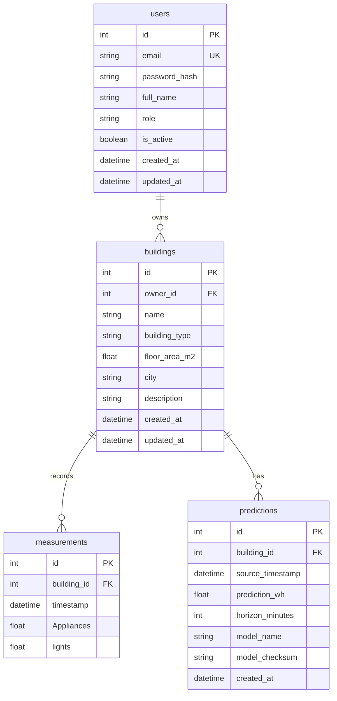

# Phase 21 database foundation

[Project overview](../README.md) | [Research architecture](system-architecture.md)

This independent application persistence layer adds schema and migrations only. Existing research routes, health payload, inference helpers, results and dashboard remain unchanged and do not require a database. No signup/login, authorization, CRUD endpoints, import, sensor feed, automatic prediction persistence or new ML functionality is implemented.

## Technology and configuration

SQLAlchemy 2.x ORM with synchronous, short-lived sessions; Alembic versioned migrations. SQLite uses Python's standard-library driver, requiring no local server. It suits a local Bachelor demo with limited write concurrency. It is not a production concurrency or security guarantee.

`DATABASE_URL` defaults to `sqlite:///./smartenergy.db`. Relative SQLite paths resolve against the repository root even if the process starts elsewhere. File creation occurs only on a connection/use, never when importing the module. The default engine/session factory are in [database.py](../backend/database.py). No database is opened by the existing research application startup. Do not place credentials in source, audit JSON or command logs.

For a future PostgreSQL deployment, configure a driver-qualified URL such as `postgresql+psycopg://...` through the environment and install the selected driver separately. No PostgreSQL service or driver is required or installed here. ORM types, named constraints, foreign keys and migrations are portable SQLAlchemy constructs; PostgreSQL offline migration SQL is tested, but no real PostgreSQL server has been integration-tested. SQLite `PRAGMA foreign_keys=ON` is enabled per connection; `check_same_thread=False` supports FastAPI's thread execution while each request owns its own session. A session must never be shared across requests/threads.

## Tables and ownership



The diagram abbreviates measurements and optional recommendation fields. Exact ORM definitions are in [db_models.py](../backend/db_models.py); internal data-transfer schemas are separate in [db_schemas.py](../backend/db_schemas.py).

- **User:** integer primary key; required unique indexed email, password_hash and full_name; role USER/ADMIN (default USER), active boolean (default true), created/updated timestamps. No plaintext password field or password behavior exists. `UserRead` explicitly allowlists public fields and omits password_hash. This schema does not make accounts or role-based security operational. Email uniqueness is case-sensitive; normalization and credential validation belong to the future authentication phase.
- **Building:** integer primary key; required owner_id/name; optional building_type, floor_area_m2, city and description. Area must be finite and strictly positive when provided. User deletion is RESTRICTed while owned buildings exist. Ownership metadata is not part of the finalized model input contract.
- **Measurement:** integer primary key, required building_id/timestamp and all 26 raw numeric values below. `(building_id, timestamp)` is unique, with its backing composite unique index; separate building_id and timestamp indexes support history queries. A different building may have the same timestamp. No future target, rv1/rv2, occupancy or precomputed feature fields are stored.
- **Prediction:** integer primary key, building_id, source_timestamp, finite prediction_wh, positive horizon_minutes (default 10), model_name, model_checksum and created_at. Building/source-time indexes support retrieval. Multiple predictions at the same origin are allowed to retain distinct future runs. Optional recommendation_level/code/priority/text store an entire snapshot or remain all NULL; level/priority use existing engine vocabulary. The checksum column has a 64-character constraint; application DTOs additionally require lowercase SHA-256 hex. No model bytes or fabricated forecast is stored. Feature JSON was omitted to keep this foundation minimal; future operational reproducibility also needs source history, the exact feature contract and artifact identified by checksum.

Building deletion cascades to its measurements and predictions at the database level. ORM collections use `lazy="raise"`; future services must request relationships explicitly, for example with `selectinload`, and paginate large histories. There are no automatic huge eager loads. No generic CRUD/service framework was added because no database operations are exposed yet.

## Measurement semantics and validation

The cleaned dataset header and first 26 inputs of the committed [feature schema](../ml/results/feature_schema.json) define the raw contract:

| Columns | Units/meaning |
| --- | --- |
| `Appliances`, `lights` | Wh per observed ten-minute interval; lights is not occupancy |
| `T1` through `T9`, `T_out`, `Tdewpoint` | Degrees Celsius; T6 is outdoor/weather context |
| `RH_1` through `RH_9`, `RH_out` | Relative humidity percent; RH_6 is outdoor context |
| `Press_mm_hg` | mm Hg |
| `Windspeed` | m/s |
| `Visibility` | km |

Names/case are preserved exactly. Source `date` becomes `timestamp`; the final model target remains next-step Appliances Wh. See [provenance/units](../data/raw/README.md) and [feature implementation](../ml/src/feature_engineering.py). Raw rows alone do not satisfy the 42-feature inference contract: a future feature service must establish continuity and sufficient historical lags/rolling windows without future observations. No such service is implemented here. Schema uniqueness does not prove interval continuity or cross-building model validity.

Observation/source timestamps use naive datetimes in a consistent source clock. UCI timezone is not established, so this phase does not invent a UTC conversion. Application DTOs reject timezone-aware observation timestamps; direct ORM/SQL writers must follow the same convention. Audit created_at/updated_at timestamps are naive UTC, supplied by ORM defaults; updated_at advances on ORM updates. Direct SQL writers must supply required audit times and explicitly update updated_at; no cross-database timestamp triggers are claimed.

`FiniteFloat` rejects booleans, strings, NaN and infinities on bound ORM/Core writes. Required measurement/prediction columns have NOT NULL plus finite double-range SQL checks; optional area has positive/finite checks. Pydantic DTOs also reject nonfinite values. SQLite's raw driver converts a NaN bound outside these application types into SQL NULL: required numeric fields reject it, but NULL remains legitimate for optional floor area. Therefore future application writes must use validated DTOs/ORM types, not arbitrary driver SQL. Physical range clipping is not imposed: environmental values can be negative, and persisted model output is not silently clipped. No data-quality/comfort assumptions are invented.

## Migrations, initialization and sessions

From the repository root, using the project environment:

```powershell
.\.venv\Scripts\Activate.ps1
python -m pip install -r requirements.txt
python -m alembic upgrade head
python -m alembic current
```

This initializes an **empty** default local schema at revision `0021_database_foundation`. No users, buildings or measurements are seeded. The database and SQLite journal/WAL/shared-memory sidecars are ignored by Git. Back up actual application data before future migrations. Downgrading to base drops application tables/data; downgrade is exercised only on disposable test databases in this phase.

The frozen [initial migration](../backend/migrations/versions/0021_database_foundation.py) contains explicit SQLAlchemy columns/constraints, independent of future ORM edits. [Alembic configuration](../alembic.ini) and [migration environment](../backend/migrations/env.py) share the URL policy. Runtime code does not call `create_all`. Future schema changes require reviewed migrations rather than editing this revision or recreating populated tables.

`SessionLocal` is the session factory. `get_db` is an available FastAPI dependency; it yields one session, rolls back on exceptions and closes it in all cases. Services must explicitly commit successful writes; uncommitted writes roll back on close. Do not silently auto-commit an entire HTTP response lifecycle. `check_database(engine)` is an explicit internal connection/schema/revision probe with no endpoint. Existing `/health` remains unchanged. The probe reports status, not credential-bearing URLs.

## Future reference building and authentication

A later authorized import phase can create a clearly labeled **UCI Reference Building**, owned by an explicitly provisioned user, and import the source historical measurements. This is the building represented by the research dataset on which the final model was validated. No UCI data is imported in Phase 21. Other user buildings are outside the established validation domain; ownership or schema compatibility does not establish forecasting performance there. Building name/type/description can label provenance; no synthetic occupancy or equipment evidence should be added.

The password_hash column, role and ownership foreign key prepare for future authentication. No password hashing, login/session/JWT, signup, authorization shortcut or administrative account is implemented. Existing prototype access remains a research demo, not secure account access. Prediction/recommendation snapshots are schema only: current research POST routes neither read nor write this database.

## Verification

```powershell
python -m pytest tests/test_database.py -q
python -m pytest
node --experimental-strip-types --test tests/frontend_api.test.mjs
```

Database tests use a new temporary SQLite file for each test and override DATABASE_URL only in that test. They upgrade the real initial migration, compare migrated schema to ORM metadata, exercise downgrade/re-upgrade, enforce constraints/relationships/rollback and validate safe serialization. Test-only scalar fixtures are never application seed data or research results. No test opens/modifies the developer database. PostgreSQL is checked via offline SQL generation/DDL compilation only.

Implementation references: [SQLAlchemy sessions](https://docs.sqlalchemy.org/en/20/orm/session_basics.html), [SQLite dialect/foreign keys](https://docs.sqlalchemy.org/en/20/dialects/sqlite.html), [Alembic workflow](https://alembic.sqlalchemy.org/en/latest/tutorial.html). The [Phase 21 audit](../ml/results/phase21_database_foundation.json) records actual installed versions, verification results and protected-artifact integrity. Requirements constrain the new dependencies to their major release series; this does not pin every transitive dependency or change the recorded research environment.
