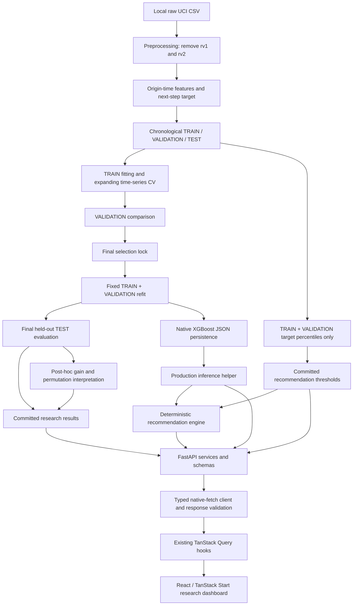

# System architecture

[Overview](../README.md) | [Methodology](research-methodology.md) | [Reproduction](reproducibility.md)

## Research and serving paths

The split node means separate partitions, not unrestricted TEST access during development. TEST serves the locked final evaluation and later equivalence/post-hoc interpretation only; calibration reads TRAIN + VALIDATION. Native persistence reconstructs the locked development fit and checks equivalence. These existing gates are not new model development.

## Python boundary

- [ML modules](../ml/src/) separate preparation, fitting, evaluation, explanation, persistence, inference and recommendations. [Results](../ml/results/) store numerical records and contracts.
- [model_inference.py](../ml/src/model_inference.py) checks metadata, model/schema/lock checksums, installed XGBoost version and ordered finite features. Production loading/prediction does not fit or read datasets.
- [recommendation_engine.py](../ml/src/recommendation_engine.py) uses forecast/current Wh and saved development thresholds. Its integrated helper extracts current Appliances from the same validated row; outputs explicitly set automatic control false and savings null.
- [FastAPI routes](../backend/main.py) delegate to [services](../backend/services.py) and [Pydantic schemas](../backend/schemas.py). Successful model/threshold loads are cached per process. Analysis endpoints read saved JSON without recomputing models, selection or importance.

Validation errors return 422, resource failures 503, and unexpected failures a generic 500. Client responses do not echo local paths or Python traces. Health checks cached usability rather than continuously re-hashing disk artifacts; restart after intentional artifact changes. No fake fallback is used.

## Frontend boundary

React/TypeScript, Vite, Tailwind, shadcn/Radix and Recharts remain within TanStack Start SSR/file routing and the Lovable Vite wrapper. The [router](../src/router.tsx) owns one QueryClient and the [root layout](../src/routes/__root.tsx) provides it. Existing server entry/error handling and CSRF middleware are preserved; no plain-SPA conversion or duplicate provider/plugin is introduced.

The [typed API client](../src/lib/api/) uses native fetch. Query hooks wait until browser mount so SSR and initial hydration remain consistently pending. Research payloads use the existing Zod dependency for shape validation. Validation comparisons and final held-out KPIs have distinct labels; gain fractions are predictive, not causal energy shares.

| Visible content | API source |
| --- | --- |
| Connection | `/health` |
| Final model / held-out metrics | `/model/info` |
| Validation chart/table | `/analysis/model-comparison` |
| Saved feature gain | `/analysis/feature-importance` |
| Development bands | `/recommendations/thresholds` |

No browser time-series buffer exists. POST functions/mutations are available, but no hidden development/test row populates widgets. Live forecasts/recommendations await genuine history. Unsupported operational/account views and actions show explicit unavailable states; legacy mock implementation code is withheld rather than represented as working services.

## Runtime assumptions

Run from the repository root with required ignored artifacts present. `VITE_API_BASE_URL` is public build-time configuration, defaulting to `http://127.0.0.1:8000`. Remote browsers need a reachable API, suitable HTTPS and explicit CORS. Local CORS uses listed origins without credentials. There is no database, authentication, account/email delivery, raw-history ingestion or automatic equipment-control service. This architecture is a research prototype, not a production-security claim.

See [backend usage](../backend/README.md), [model usage](../ml/models/README.md) and [frontend integration](../src/lib/api/README.md).
