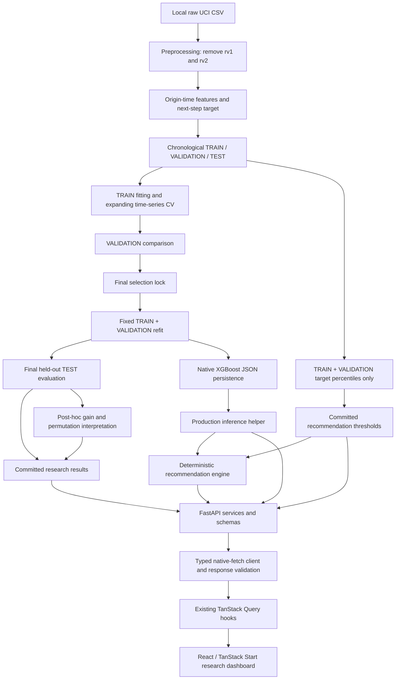
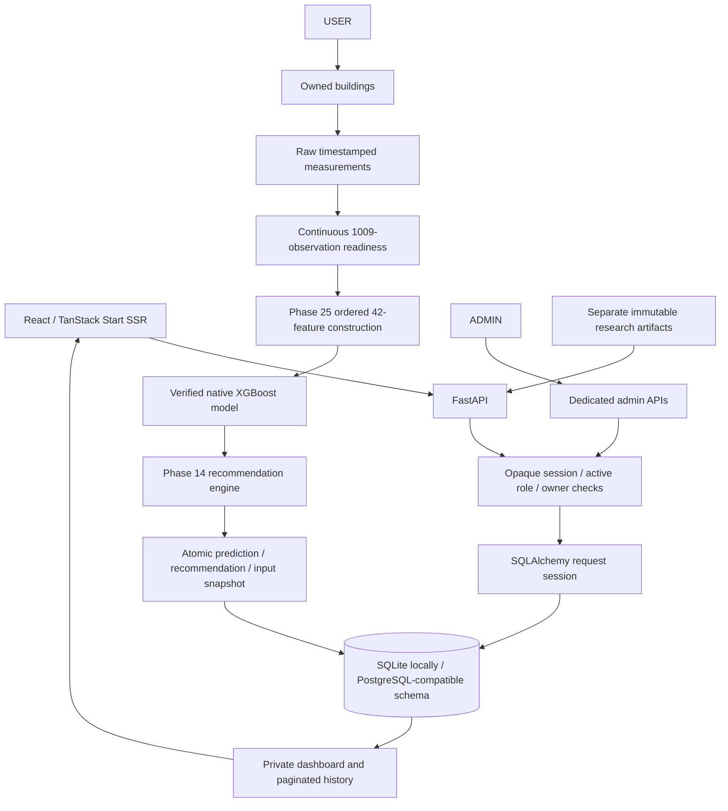

# System architecture

[Overview](../README.md) | [Methodology](research-methodology.md) | [Reproduction](reproducibility.md)

## Research and serving paths

The split node means separate partitions, not unrestricted TEST access during development. TEST serves the locked final evaluation and later equivalence/post-hoc interpretation only; calibration reads TRAIN + VALIDATION. Native persistence reconstructs the locked development fit and checks equivalence. These existing gates are not new model development.

## Python boundary

- [ML modules](../ml/src/) separate preparation, fitting, evaluation, explanation, persistence, inference and recommendations. [Results](../ml/results/) store numerical records and contracts.
- [model_inference.py](../ml/src/model_inference.py) checks metadata, model/schema/lock checksums, installed XGBoost version and ordered finite features. Production loading/prediction does not fit or read datasets.
- [recommendation_engine.py](../ml/src/recommendation_engine.py) uses forecast/current Wh and saved development thresholds. Its integrated helper extracts current Appliances from the same validated row; outputs explicitly set automatic control false and savings null.
- [FastAPI routes](../backend/main.py) delegate to [services](../backend/services.py) and [Pydantic schemas](../backend/schemas.py). Successful model/threshold loads are cached per process. Analysis endpoints read saved JSON without recomputing models, selection or importance.

Validation errors return 422, resource failures 503, and unexpected failures a generic 500. Client responses do not echo local paths or Python traces. Health checks cached usability rather than continuously re-hashing disk artifacts; restart after intentional artifact changes. No fake fallback is used.

## Frontend boundary

React/TypeScript, Vite, Tailwind, shadcn/Radix and Recharts remain within TanStack Start SSR/file routing and the Lovable Vite wrapper. The [router](../src/router.tsx) owns one QueryClient and the [root layout](../src/routes/__root.tsx) provides it. Existing server entry/error handling and CSRF middleware are preserved; no plain-SPA conversion or duplicate provider/plugin is introduced.

The [typed API client](../src/lib/api/) uses native fetch. Query hooks wait until browser mount so SSR and initial hydration remain consistently pending. Research payloads use the existing Zod dependency for shape validation. Validation comparisons and final held-out KPIs have distinct labels; gain fractions are predictive, not causal energy shares.

| Visible content | API source |
| --- | --- |
| Connection | `/health` |
| Final model / held-out metrics | `/model/info` |
| Validation chart/table | `/analysis/model-comparison` |
| Saved feature gain | `/analysis/feature-importance` |
| Development bands | `/recommendations/thresholds` |

## Final full-stack application path

Signup/login persist Argon2id password hashes and digest-only opaque sessions. The host-only HttpOnly cookie has SameSite=Lax and configurable Secure/absolute expiry. Private mutations require the existing non-simple CSRF header plus trusted Origin when supplied. Credentialed CORS lists exact frontend origins. Ordinary building resources are owner-only for both roles; dedicated ADMIN APIs provide cross-owner inspection and guarded activation changes. Logout clears private queries; identity/building/page/window keys isolate caches.

`users` own `buildings`; buildings own `measurements` and `predictions`; `auth_sessions` belong to users. [Database architecture](database-architecture.md) lists current fields/constraints. Every request gets a short-lived session with explicit commit/rollback. CSV imports are atomic; DB uniqueness resolves races. No startup seed, fake account or model fit occurs.

Measurement inputs are 26 raw finite values, not frontend-engineered features. The latest continuous 1,009-observation window supplies lags through t-1008; shared research formulas construct the exact 42 values. Explicit forecasting stores source time, Wh, ten-minute horizon, model checksum, canonical feature snapshot/hash and recommendation snapshot. Identity is building/source/model/features. Dashboard matching distinguishes stale history, including corrected historical input. See [forecast lifecycle](building-predictions.md) and [dashboard](user-dashboard.md).

## Runtime assumptions

Use **localhost** consistently: frontend `http://localhost:5173`, default public build-time API base `http://localhost:8000`. Uvicorn can bind loopback while the browser uses localhost. Configure `SMARTENERGY_CORS_ORIGINS` explicitly for other frontend origins; credentials are enabled. Keep HTTPS/Secure-cookie policy coherent for deployment.

The verified ignored native model is needed for forecasting/model health. Runtime inference does not read raw/processed CSVs. Raw UCI history is needed only for explicit reference import or research reproduction. Research endpoints remain separate from the operational database. The local DB is created through migrations, never committed. There is no IoT stream, scheduler, physical control or measured savings service. SQLite concurrency, experimental cross-building transfer and prototype security limits remain explicit.

See [backend usage](../backend/README.md), [model usage](../ml/models/README.md), [authentication](authentication.md), [admin panel](admin-panel.md) and [frontend integration](../src/lib/api/README.md).
